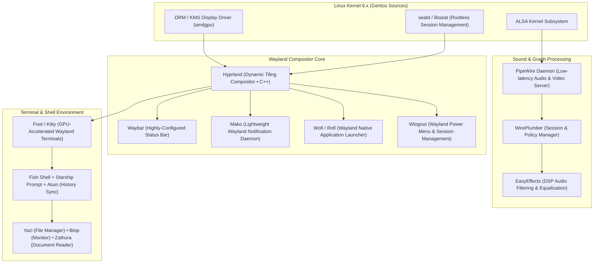

<div align="center">

# Gentoo Linux Hyprland Workstation Environment

### Deterministic Wayland Compositor, PipeWire, Custom Toolchain & TUI Architecture
<p><strong>A high-throughput, minimal-latency development environment built on Gentoo Linux, Hyprland, and the Wayland graphics stack.</strong></p>

<p>
  
  
  
  
  
  
</p>

</div>

---

### Overview & Operational Scope

This repository houses the complete, reproducible user-space configuration for a production **Gentoo Linux workstation**. Built around the **Hyprland** dynamic tiling Wayland compositor, it eliminates legacy X11 overhead in favor of direct DRM/KMS buffer sharing, low-latency PipeWire audio graphs, and a keyboard-centric Terminal User Interface (TUI) workflow.

Designed to operate seamlessly on high-performance x86_64 hardware (including AMD AM5 Zen 4 platforms with AMD RDNA2/3 graphics), the environment prioritizes:
- **Zero Latency**: Direct hardware scanout via Wayland with tearing disabled for desktop productivity and variable refresh rate (VRR) support.
- **Portage Optimization**: Custom package USE flags and GCC/Clang native march optimizations (`-march=native -O2 -pipe`).
- **Security & Privacy Posture**: GnuPG smart-card agent forwarding, DNSCrypt-proxy encrypted DNS, and Firejail application sandboxing.

---

### Table of Contents

1. [Desktop Environment & System Verification](#1-desktop-environment--system-verification)
2. [Software Architecture & Core Stack](#2-software-architecture--core-stack)
3. [Configuration Topology (.config)](#3-configuration-topology-config)
4. [Audio & Media Pipeline (PipeWire)](#4-audio--media-pipeline-pipewire)
5. [Security, Cryptography & Network Privacy](#5-security-cryptography--network-privacy)
6. [Portage Installation & USE Configuration](#6-portage-installation--use-configuration)
7. [License](#7-license)

---

### 1. Desktop Environment & System Verification

#### Primary Desktop Workspace & Multi-Monitor Layout
<p align="center">
  
</p>

#### Hyprland Dynamic Tiling Environment
<p align="center">
  
</p>

#### Telemetry & Development Stack
<p align="center">
  
  
</p>

---

### 2. Software Architecture & Core Stack



---

### 3. Configuration Topology (`.config`)

The configuration tree is partitioned into modular, isolated directory structures:

| Directory | Subsystem / Role | Key Configuration Highlights |
| :--- | :--- | :--- |
| **`.config/hypr/`** | **Hyprland Compositor** | Window rules, monitor scaling, workspace bindings, touchpad gestures, animation bezier curves. |
| **`.config/waybar/`** | **Status Bar** | Custom JSON/CSS modules for CPU load, RAM usage, audio volume, workspace indicators, and tray. |
| **`.config/foot/`** | **Primary Terminal** | Wayland-native server-client daemon mode, low memory footprint, TrueColor rendering. |
| **`.config/fish/`** | **Shell Architecture** | Abbreviations, interactive completion functions, Starship prompt initialization. |
| **`.config/atuin/`** | **Shell History Engine** | SQLite-backed encrypted shell history database with fuzzy search index. |
| **`.config/yazi/`** | **File Management** | High-performance asynchronous terminal file manager with Catppuccin flavor theme. |
| **`.config/btop/`** | **Hardware Monitor** | Real-time multi-core CPU, GPU, memory, and NVMe I/O performance telemetry. |
| **`.config/zathura/`** | **Document Viewer** | Minimalist keyboard-driven PDF/PostScript viewer using Poppler rendering engine. |
| **`.config/mako/`** | **Notifications** | Border styling, timeout rules, and urgency coloring for desktop notifications. |
| **`.config/Kvantum/`**| **Qt Styling Engine** | Catppuccin Macchiato Lavender theme for unified Qt5/Qt6 and GTK visual parity. |

---

### 4. Audio & Media Pipeline (PipeWire)

Audio routing is handled entirely by **PipeWire** and **WirePlumber**, replacing legacy PulseAudio and JACK:
- **Bit-Perfect Playback**: Automatically adapts sample rates (44.1 kHz, 48 kHz, 96 kHz, 192 kHz) according to sink capabilities.
- **Low-Latency Pro Audio**: Configured with quantum buffers (`PIPEWIRE_LATENCY="64/48000"`) for near-zero delay during real-time processing.
- **EasyEffects Integration**: Background DSP equalization profiles mapped automatically upon output device connection.

---

### 5. Security, Cryptography & Network Privacy

- **GnuPG Subsystem ([`.gnupg/`](.gnupg/))**:
  Hardened `gpg.conf` and `gpg-agent.conf` enforcing SHA-512 digest preferences, AES-256 cipher preferences, and automated SSH-agent emulation via `enable-ssh-support`.
- **DNSCrypt-Proxy ([`.config/dnscrypt-proxy.toml`](.config/dnscrypt-proxy.toml))**:
  Local DNS resolver encrypting outbound requests with DNS-over-HTTPS (DoH) and DNSCrypt protocols, blocking ISP-level DNS hijacking.
- **Sandboxing with Firejail**:
  Isolation profiles applied to untrusted network applications and browsers to restrict filesystem access and syscall surfaces.

---

### 6. Portage Installation & USE Configuration

For users replicating this environment on a fresh Gentoo stage3 installation:

#### 1. Global & Package USE Flags

Ensure the following USE flags are enabled in `/etc/portage/make.conf` or `/etc/portage/package.use/`:

```bash
# Global Wayland and PipeWire enablement
echo "*/* wayland pipewire seatd elogind -X -pulseaudio" >> /etc/portage/package.use/desktop

# Compositor & core tools
echo "gui-wm/hyprland wayland" >> /etc/portage/package.use/hyprland
echo "gui-apps/waybar network wifi pulseaudio tray" >> /etc/portage/package.use/waybar
echo "gui-apps/foot" >> /etc/portage/package.use/terminal
```

#### 2. Core Package Installation

```bash
# Update Portage tree
emerge --sync

# Install display and session infrastructure
emerge --ask gui-wm/hyprland gui-apps/waybar gui-apps/foot gui-apps/wofi \
             gui-apps/mako media-video/pipewire media-video/wirePlumber \
             sys-auth/seatd sys-auth/elogind

# Install shell & productivity utilities
emerge --ask app-shells/fish app-shells/starship app-misc/yazi \
             sys-process/btop app-text/zathura app-text/zathura-pdf-poppler
```

#### 3. Deploying Configuration Files

Clone the repository and synchronize `.config` files into your `$HOME`:

```bash
git clone https://github.com/zx0r/gentoo-hyprland-config.git ~/gentoo-hyprland-config
cd ~/gentoo-hyprland-config

# Copy configurations to ~/.config
cp -r .config/* ~/.config/
```

---

### 7. License

Distributed under the [MIT License](LICENSE). Copyright (c) 2026 zx0r.
System configurations, styles, and scripts are provided for educational and systems engineering use.
